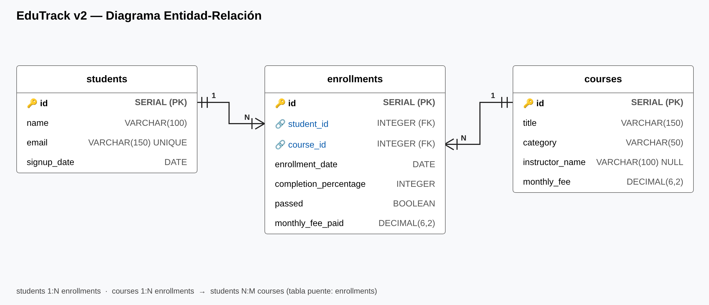

# EduTrack v2 — Informe de análisis

## 1. Modelo de datos

| Tabla | PK | FK | Descripción |
|---|---|---|---|
| `students` | `id` | — | 8 estudiantes (nombre, email único, fecha de alta) |
| `courses` | `id` | — | 7 cursos (título, categoría, instructor, cuota mensual) |
| `enrollments` | `id` | `student_id → students.id`, `course_id → courses.id` | 16 inscripciones con progreso, aprobado y cuota pagada |

**Relaciones**

- `students` **1:n** `enrollments`: un estudiante puede tener varias inscripciones.
- `courses` **1:n** `enrollments`: un curso puede tener varios inscritos.
- `students` **n:m** `courses`: se resuelve con la tabla puente `enrollments`.

En la v2 el nombre del instructor ya no está en `enrollments`, sino en `courses` (normalización: se evita repetirlo en cada inscripción).

## 2. Consultas INNER JOIN

### 2.1 Inscripciones con estudiante, curso y % de completado

Devuelve **16 filas**, una por inscripción. Ni Giulia Romano (sin inscripciones) ni el curso *Email Campaigns* (sin inscritos) aparecen, porque INNER JOIN solo devuelve filas con coincidencia en ambas tablas.

- Mayor progreso: Marco Rossi en *Advanced Python* (95 %) y Klaus Weber en *Intro to Python* (92 %).
- Hay 3 inscripciones al 0 %: dos en *UI/UX Fundamentals* y la de Lucia Fernandes en *Advanced Python*. Lucia, además, solo lleva un 5 % y un 3 % en sus otros dos cursos.

### 2.2 Estudiantes que han aprobado al menos un curso

| Estudiante | Email | Curso aprobado |
|---|---|---|
| Emily Watson | emily.watson@student.edutrack.com | Intro to Python |
| Klaus Weber | klaus.weber@student.edutrack.com | Data Analysis with SQL |
| Klaus Weber | klaus.weber@student.edutrack.com | Intro to Python |
| Marco Rossi | marco.rossi@student.edutrack.com | Advanced Python |
| Marco Rossi | marco.rossi@student.edutrack.com | Intro to Python |
| Priya Sharma | priya.sharma@student.edutrack.com | Digital Marketing 101 |

**6 aprobados de 16 inscripciones (37,5 %)**, repartidos entre **4 estudiantes**. Klaus Weber y Marco Rossi han aprobado todos sus cursos.

### 2.3 % de completado medio por instructor

| Instructor | % medio | Inscripciones |
|---|---|---|
| Marta López | 66,14 | 7 |
| Carlos Vega | 40,00 | 5 |
| Lucia Prades | 36,50 | 2 |
| Pending assignment | 0,00 | 2 |

- Marta López lidera con diferencia y además concentra más inscripciones (*Intro to Python* y *Data Analysis with SQL*).
- *UI/UX Fundamentals* no tiene instructor asignado y sus 2 alumnos están al 0 %, lo que apunta a que la falta de instructor bloquea el avance.

## 3. Consultas LEFT JOIN (datos faltantes)

### 3.1 Estudiantes sin ninguna inscripción

| id | Estudiante | Email | Alta |
|---|---|---|---|
| 8 | Giulia Romano | giulia.romano@student.edutrack.com | 2024-05-07 |

1 estudiante de 8 se registró pero nunca se apuntó a un curso.

### 3.2 Cursos sin ninguna inscripción

| id | Curso | Categoría | Instructor |
|---|---|---|---|
| 7 | Email Campaigns | Marketing | Lucia Prades |

1 curso de 7 no tiene ningún inscrito. Además es el más barato del catálogo (19,99 €).

## 4. Agregación entre tablas

### 4.1 Estudiantes inscritos en más de un curso

| Estudiante | Cursos |
|---|---|
| Emily Watson | 3 |
| Lucia Fernandes | 3 |
| Klaus Weber | 2 |
| Marco Rossi | 2 |
| Pierre Dubois | 2 |
| Priya Sharma | 2 |
| Yuki Nakamura | 2 |

Los 7 estudiantes con inscripciones están en más de un curso. Es decir, todo el que se apunta repite.

### 4.2 Ingresos totales por categoría (`courses.monthly_fee`)

| Categoría | Ingresos | Inscripciones |
|---|---|---|
| Programming | 409,93 € | 7 |
| Data | 179,97 € | 3 |
| Design | 169,96 € | 4 |
| Marketing | 59,98 € | 2 |
| **Total** | **819,84 €** | **16** |

Programming genera el 50 % de los ingresos.

### 4.3 Estudiantes por instructor

| Instructor | Estudiantes distintos | Inscripciones |
|---|---|---|
| Marta López | 6 | 7 |
| Carlos Vega | 3 | 5 |
| Lucia Prades | 2 | 2 |
| Pending assignment | 2 | 2 |

Se usa `COUNT(DISTINCT student_id)` para no contar dos veces a un estudiante inscrito en dos cursos del mismo instructor. Por ejemplo, Klaus Weber está en dos cursos de Marta López.

## 5. Integridad de datos

| Comprobación | Registros huérfanos |
|---|---|
| `enrollments.student_id` sin estudiante | 0 |
| `enrollments.course_id` sin curso | 0 |

No hay registros huérfanos. Es lo esperado, porque las claves foráneas (`REFERENCES`) impiden insertar inscripciones que apunten a estudiantes o cursos inexistentes.

## 6. Conclusiones

- **Rendimiento:** Marta López tiene el mejor % de completado medio (66 %) y la mayor base de estudiantes (6).
- **Curso más popular:** *Intro to Python* es el curso con más inscripciones y más aprobados.
- **Ingresos:** Programming es la categoría líder, con el 50 % de los ingresos.
- **Riesgos detectados:**
  - *UI/UX Fundamentals* no tiene instructor asignado y sus alumnos están al 0 %.
  - Lucia Fernandes tiene un progreso muy bajo en sus 3 cursos.
  - Giulia Romano se dio de alta pero nunca se inscribió.
  - *Email Campaigns* no tiene ningún alumno.
- **Calidad de datos:** la integridad referencial es correcta, sin registros huérfanos.